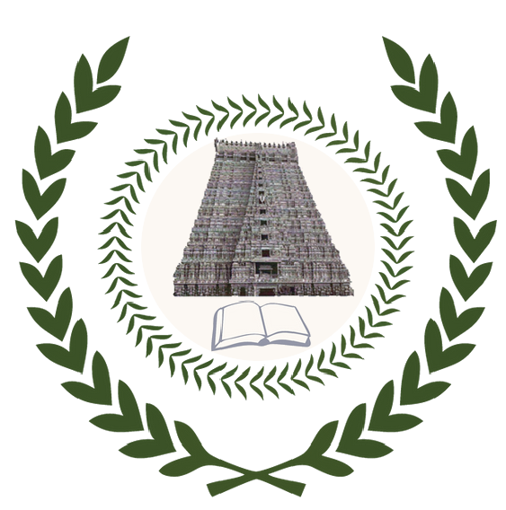

<p align="center">
  <a href="https://github.com/IIIT-Trichy-Devs">
    
  </a>
</p>

<h1 align="center">IIIT Trichy Devs · Events & Workshops</h1>

<p align="center">
  <strong>Hackathons, technical workshops, hands-on bootcamps, and developer meetups at IIIT Trichy.</strong>
</p>

<p align="center">
  
</p>

<p align="center">
  <a href="https://github.com/IIIT-Trichy-Devs/events/issues">
    
  </a>
  <a href="https://github.com/IIIT-Trichy-Devs/community/discussions">
    
  </a>
  <a href="https://github.com/IIIT-Trichy-Devs">
    
  </a>
</p>

---

## 🎯 About Events

This repository coordinates all technical events organized and hosted by the **IIIT Trichy Devs** community.

Here you will find:
- 📅 **Schedules and announcements** for upcoming hackathons, talks, and hands-on coding sessions.
- 📂 **Event materials**: presentation slides, source code, setup instructions, and reference repositories.
- 🎙️ **Speaker and workshop proposals** submitted by students, alumni, and guest developers.

---

## 🚀 Event Formats

| Format | What It Is | Who It's For |
|---|---|---|
| ⚡ **Hackathons** | Fast-paced team building sprints solving real problems with prizes and mentorship. | Beginners & experienced builders |
| 🛠️ **Hands-on Workshops** | Practical sessions where you build alongside the speaker (Git, Web, Cloud, ML, etc.). | Anyone eager to learn new tech |
| 🎙️ **Tech Talks** | Insightful talks by senior students, alumni, and industry engineers sharing deep technical insights. | Everyone |
| 🏆 **Coding Contests** | Algorithm sprints and competitive programming challenges to sharpen problem-solving skills. | CP enthusiasts & interview preppers |

---

## 📅 Upcoming Schedule

| Event | Topic / Title | Date & Time | Mode / Venue | Registration / Details |
|---|---|---|---|---|
| **Community Kickoff** | Welcome to IIIT Trichy Devs: Roadmap & Vision | *Announcing Soon* | Hybrid / Campus | [Join Discussion](https://github.com/IIIT-Trichy-Devs/community/discussions) |
| **Workshop #1** | Git & GitHub Mastery for Open Source | *Upcoming* | On-Campus | *TBA* |
| **Hackathon #1** | Annual Student Hackathon | *Stay Tuned* | Hybrid | *TBA* |

*(Have an idea for a session? See [Propose a Workshop](#-propose-a-workshop-or-talk) below!)*

---

## 🎤 Propose a Workshop or Talk

Are you passionate about a technology, framework, tool, or project? Share your knowledge with your peers!

1. Open an issue in this repository using the title `[Proposal] <Your Session Title>`.
2. Include:
   - Topic and brief abstract
   - Target audience (Beginner / Intermediate / Advanced)
   - Duration and format (Hands-on workshop, talk, AMA)
   - Prerequisites / required tools
3. Maintainers and community members will coordinate date, venue, and logistical support.

---

## 📁 Repository Structure for Event Materials

Whenever an event concludes, its presentation slides, starter code, and references are archived under:

```text
events/
└── YYYY-MM-DD-<event-slug>/
    ├── README.md        # Session overview, agenda, links
    ├── slides/          # PDF slides / presentation decks
    └── code/            # Demo starter & solution code
```

---

<p align="center">
  <em>Built by students, for students.</em><br>
  <strong>IIIT Trichy Devs</strong> · Indian Institute of Information Technology, Tiruchirappalli
</p>
